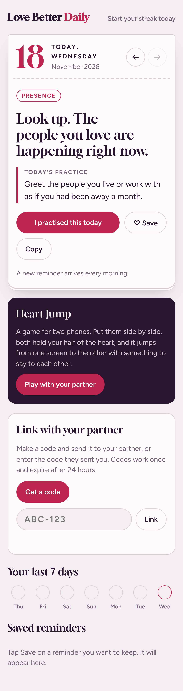

# Love Better

Love Better Daily is a page-a-day reminder for loving people better. It includes **Heart Jump**, a game for two phones, and **code-based partner linking**.



## What’s here

| Path | What it is |
| --- | --- |
| `public/index.html` | The app: daily reminders, streaks, saved reminders, Heart Jump, and the new **Link with your partner** card |
| `artifact/love-better-daily.html` | The original Love Better Daily artifact from claude.ai, unchanged, kept for reference |
| `src/pairing.js` | Partner-linking logic (invite codes) |
| `src/store.js` | Storage: Upstash Redis (used on Vercel) or in-memory (local) |
| `src/api.js` | The API, shared by the local server and the Vercel functions |
| `src/server.js` | Local server for `npm start` |
| `api/` | Vercel functions (each one just loads `src/api.js`) |
| `vercel.json` | Vercel settings: serve `public/`, no build step |
| `test/` | Tests (`npm test`) |

## Run it

```bash
npm start          # http://localhost:3000  (PORT=... to change). Uses memory, or Redis if the Upstash variables are set
npm test
```

Needs Node 18+. There are no dependencies to install.

## Deploy on Vercel

Vercel runs short-lived functions with no memory between requests, so partner links need a database. The app uses **Upstash Redis**, which has a free plan.

1. Import this repo into Vercel. Leave the framework preset as **Other**; `vercel.json` sets everything else.
2. In the Vercel project, open **Storage** (or **Marketplace**), add **Upstash for Redis**, and connect it to this project. This sets the `KV_REST_API_URL` and `KV_REST_API_TOKEN` environment variables for you. `UPSTASH_REDIS_REST_URL` / `UPSTASH_REDIS_REST_TOKEN` also work.
3. **Redeploy** so the new variables take effect.

Until the database is connected, the page still works, and the link card explains what's missing.

Heart Jump checks in with the server about every 0.6 seconds while the game is open, and stops when it's closed. Each check-in uses a few Redis commands, so a long session uses a few thousand of the free plan's monthly allowance.

## How linking works

1. Partner A taps **Get a code** and gets a code like `KVK-DFY`, then shares it.
2. Partner B types it in and taps **Link**. Both phones now show "You're linked".
3. Heart Jump now connects the two linked phones through a private room that only the couple can join.

Rules:
- Codes are 6 characters with no look-alike characters (no 0/O or 1/I/L). Dashes, spaces and lowercase are accepted when typing.
- A code works **once** and **expires after 24 hours**. Making a new code cancels the old one.
- You can't use your own code, and nobody can be linked to two partners at once.
- After 5 wrong codes in 15 minutes, code entry is locked for a while to stop guessing.
- Either partner can **Unlink**. That ends the link for both of them and closes their room.

On claude.ai, Heart Jump still uses the artifact's built-in live room, as before.

## API

All requests identify the user with an `X-User-Id` header.

| Method & path | Body | Result |
| --- | --- | --- |
| `GET /api/link` | | `{ linked, partnerId, coupleId }` or `{ linked: false, invite }` |
| `POST /api/link/invite` | | `{ code, display, expiresAt }` |
| `DELETE /api/link/invite` | | `{ cancelled }` |
| `POST /api/link/redeem` | `{ code }` | `{ coupleId, partnerId, linkedAt }` |
| `DELETE /api/link` | | `{ unlinked, coupleId }` |
| `GET /api/room?peer=ID` | | Checks in, and returns `{ peers }`: the couple's open game screens and their state |
| `POST /api/room/presence` | `{ peer, presence }` | `{ ok }` (replaces that screen's state) |

Errors come back as `{ error, message }` with a fitting status code, for example `404 invalid_code`, `410 expired_code` or `429 too_many_attempts`.

## Before production

- **Identity:** each device makes a random id, which is fine for a demo. Replace `X-User-Id` with real sign-in so a link belongs to an account rather than a browser.
- **Storage:** locally, without Redis variables, links are kept in memory and lost on restart. Set the Upstash variables to use Redis locally too.
